## Worum es geht

::: {.process}
**Begriff** → **Kriterien** → **Modellannahmen** → **Daten und Operationen** → **Ergebnis mit Aussagegrenze**
:::

Der „perfekte Gipfel“ ist kein Sonderfall. Er zeigt das Grundmuster jeder GIS-Analyse: Ein fachlicher Begriff wird erst durch explizite Entscheidungen berechenbar.

## Ausgangspunkt: eine anschauliche Frage

::: {layout-align="center"}
[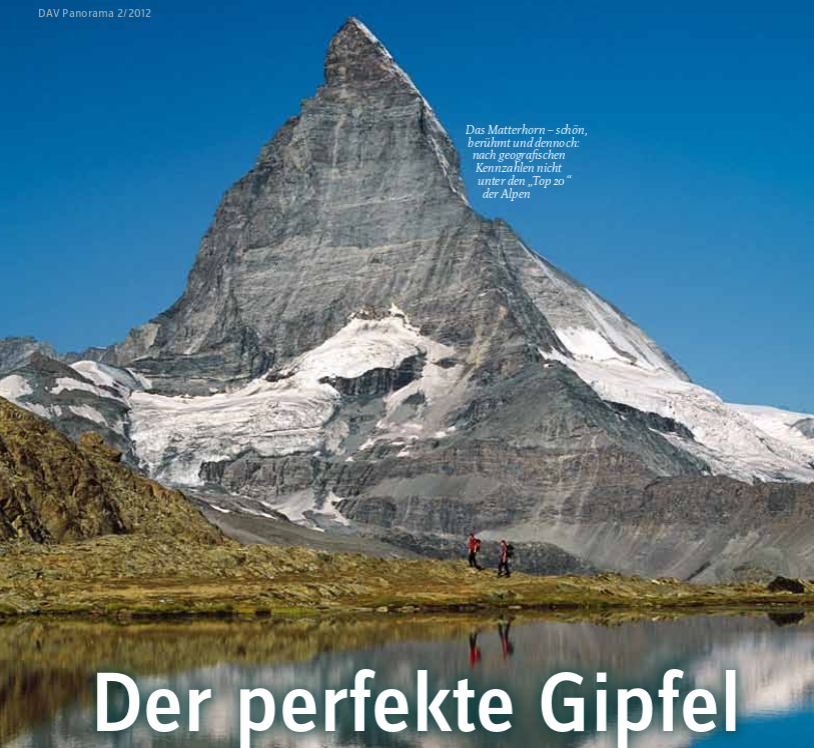{.tallfig}](../../../assets/pdf/DAV_Panorama_2_2012.pdf)
:::

::: {.keyline}
Die Frage lautet nicht: „Welcher Gipfel sieht wichtig aus?“ Sondern: **Welche Eigenschaften sollen Eigenständigkeit beschreiben – und wie lassen sie sich prüfen?**
:::

## Vom Begriff zu Kriterien

::: {layout-ncol="2" layout-valign="center"}
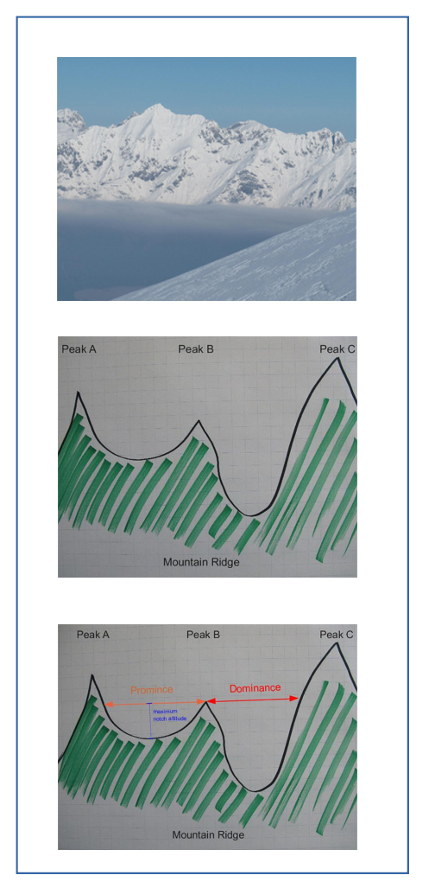{.tallfig}

::: {.framebox}
**Benötigte Größen**

- Gipfelhöhe $h$
- Dominanz $d$
- maßgebliche Schartenhöhe
- Prominenz $p$
- Eigenständigkeitswert $E$
:::
:::

::: {.small}
Nicht jede Größe liegt direkt im DGM vor. Dominanz, Scharte und Prominenz werden aus räumlichen Beziehungen abgeleitet.
:::

## Die E-Formel ist eine Modellentscheidung

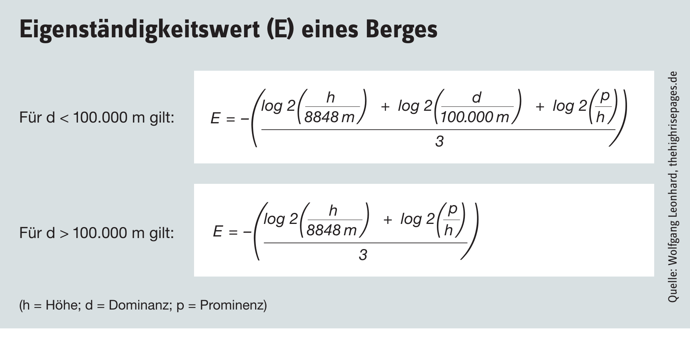{.fullfig}

::: {.keyline}
Die Formel setzt voraus, dass $h$, $d$ und $p$ bereits fachlich begründet bestimmt wurden. Sie ersetzt diese Entscheidungen nicht.
:::

## Was der Artikel offen lässt

::: {.docgrid}
::: {.doccard}
**Gipfel**

Welche lokalen Maxima oder Plateaus zählen?
:::
::: {.doccard}
**Höheres Gelände**

Ab welchem Höhenunterschied ist es relevant?
:::
::: {.doccard}
**Scharte**

Wie wird die beste Verbindung gesucht und wann gilt sie als gefunden?
:::
::: {.doccard}
**Geltung**

Wann reicht der DGM-Ausschnitt für eine belastbare Aussage?
:::
:::

## Modellbildung dokumentieren

::: {layout-ncol="2" layout-valign="center"}
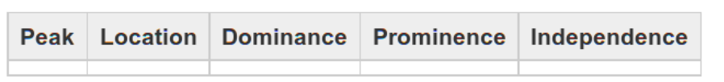{.fullfig}

::: {.framebox}
**Dokumentiert werden:**

- Gipfelmaske und Plateau-Regel
- DGM, Rastergitter und KBS
- Nachbarschaft und Höhentoleranz
- Suchregel und Datenrand
:::
:::

## Von der Frage zum QGIS-Workflow

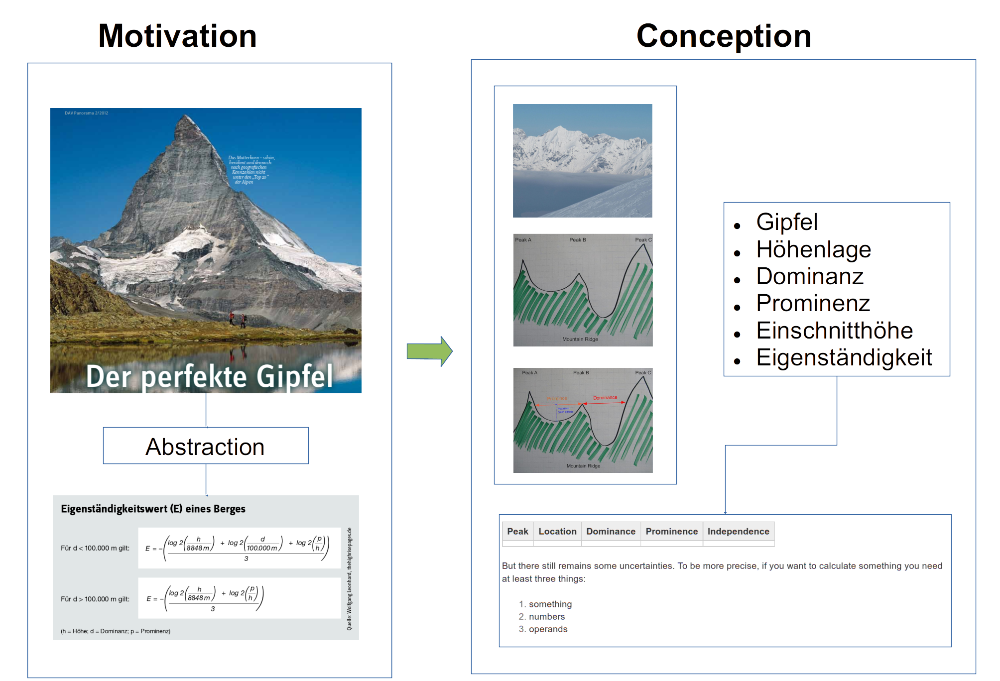{.fullfig}

::: {.keyline}
Nicht die Bedienungsschritte sind der Workflow. Der Workflow beschreibt, **welche fachliche Entscheidung** mit welchem Ergebnislayer geprüft wird.
:::

## Arbeitspakete statt Werkzeugliste

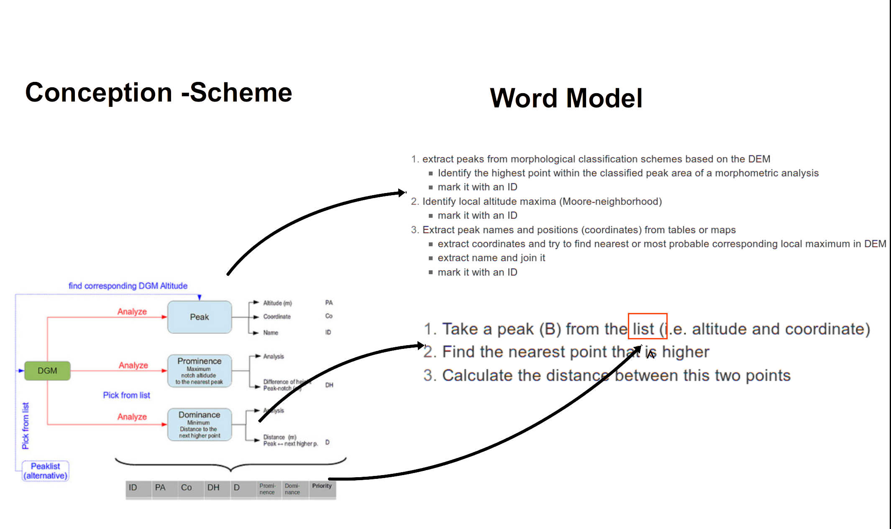{.fullfig}

::: {.process}
1. Gipfelkandidaten definieren · 2. höheres Gelände bestimmen · 3. Distanz prüfen · 4. Scharte eingrenzen · 5. Ergebnis und Grenze dokumentieren
:::

## Umsetzung kann interaktiv beginnen

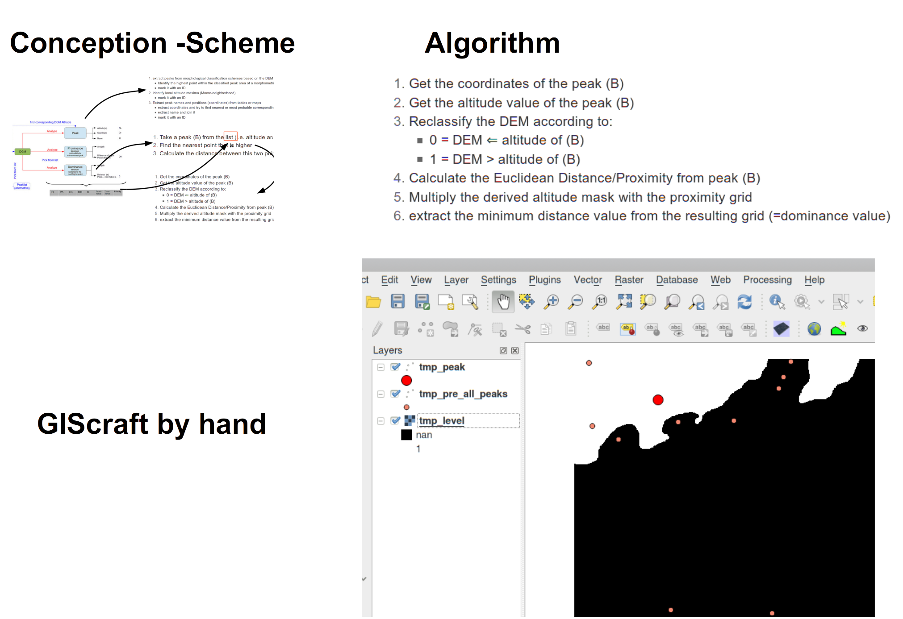{.fullfig}

Die lokale Hypothese wird als Linie und Schartenpunkt gespeichert. Sie ist ein prüfbarer Start, kein endgültiger Nachweis.

## … und reproduzierbar werden

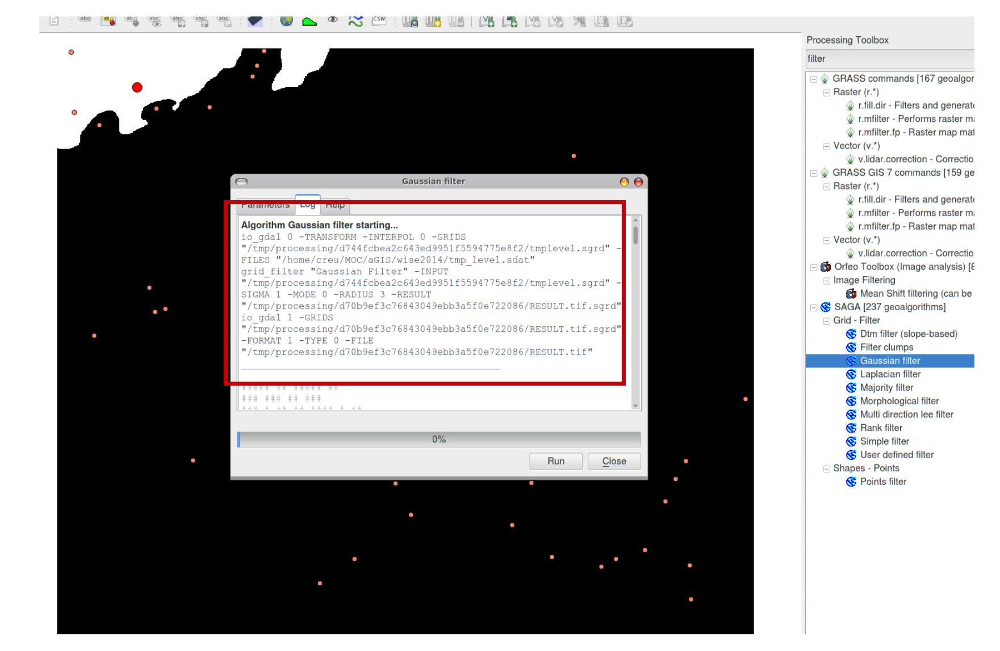{.fullfig}

Rastermaske, Proximity und Höhenstufen machen die einzelnen Prüfungen wiederholbar. Das Skript automatisiert nur diese klar definierten Schritte.

## Nicht Code, sondern eine nachvollziehbare Regel

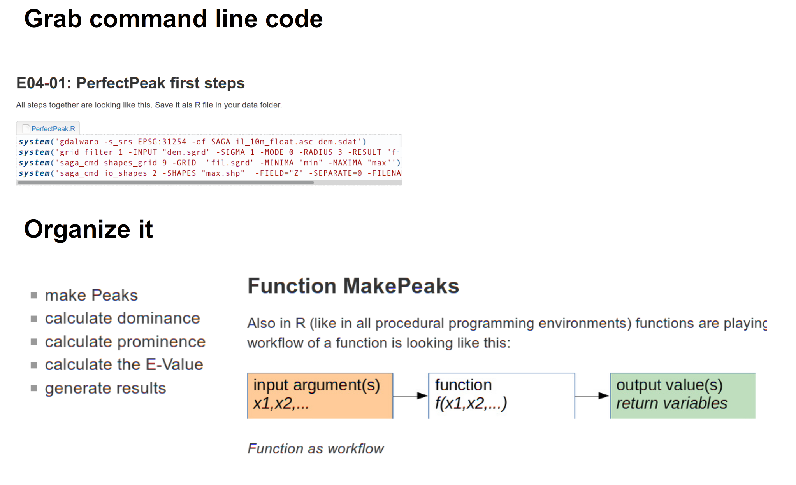{.fullfig}

::: {.keyline}
Eine gute Umsetzung zeigt Eingaben, Parameter, Ergebnis und Abbruchregel – unabhängig davon, ob sie geklickt, modelliert oder programmiert wurde.
:::

## Übersetzung in GIS-Anforderungen

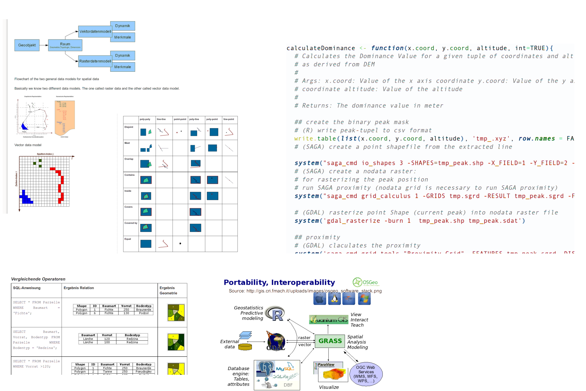{.fullfig}

| Fachliche Frage | Technische Übersetzung |
|:--|:--|
| Was zählt als Gipfel? | Gipfelmaske oder Punktlayer |
| Wo liegt höheres Gelände? | Höhenmaske über $h$ |
| Wie weit ist es entfernt? | Distanzraster / Proximity |
| Wo liegt die Scharte? | Zusammenhang über Höhenstufen |

## Prominenz durch Fluten denken

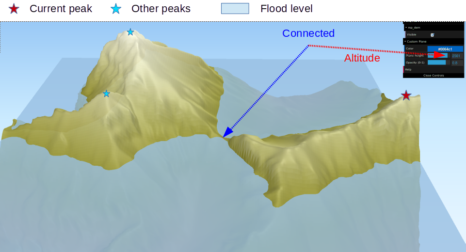{.fullfig}

Bei hoher Schwelle sind Gipfelbereiche getrennt. Mit sinkender Schwelle wachsen die Zusammenhangsflächen.

## Die maßgebliche Verbindung suchen

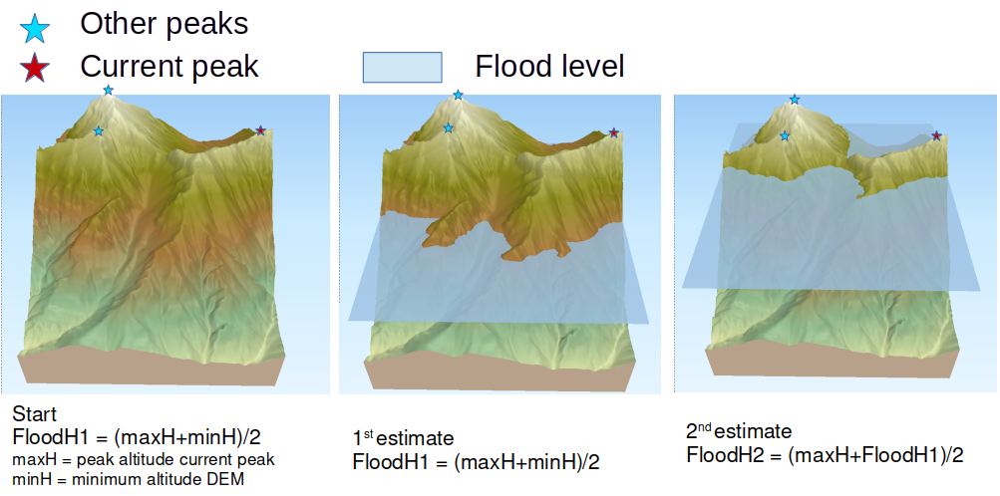{.fullfig}

Gesucht ist nicht der erstbeste Grat, sondern die **höchste** Schwelle, bei der die Fläche des Zielgipfels höheres Gelände erreicht.

## Abbruch und Aussagegrenze

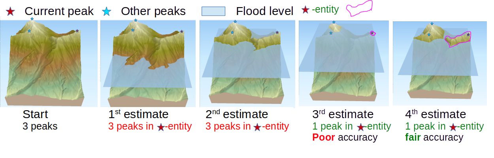{.fullfig}

::: {.keyline}
Dokumentiert werden die letzte getrennte und die erste verbundene Stufe. Berührt die Fläche den DGM-Rand, bleibt das Ergebnis ausschnittsbezogen.
:::

## Übergang zum Arbeitsblatt

::: {.process}
Das Arbeitsblatt setzt dieses Modell um: erst lokale Hypothese, dann DGM-Ausschnitt erweitern, Dominanz und Schartenintervall prüfen, anschließend E-Wert und Status transparent ausgeben.
:::

**Merksatz:** Ein GIS-Ergebnis besteht aus **Wert, Regel, Parametern und Aussagegrenze**.
